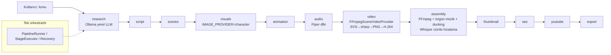

# FAZ 1 — Atölye V2 durum incelemesi (19 Ekim 2026)

## Git ve yedek

| Öğe | Değer |
| --- | --- |
| Ana repo | `D:\ÜRETİM\Atolye\atolye-v2`, dal `wip/ayas-graphify-final-execution`, temiz, `origin` ile eşit |
| Yedek etiketi | `atolye-v2-pre-v3-backup` → `69bda564` |
| V3 çalışma alanı | **Ayrı git worktree** `D:\ÜRETİM\Atolye\atolye-v2-v3`, dal `feature/cop-adam-v3` |
| Son 40 commit | 13 fix, 11 test, 11 docs, 5 feat — neredeyse tamamı AYAS (asistan, canlı yayın, erişim denetçisi) |
| Uzak dallar | `main` + 12 çalışma dalı; etiket yoktu (ilk etiket bu yedek) |

**Neden ayrı worktree:** canlı AYAS Observer'ı her turda ana çalışma ağacındaki kodu çalıştırıyor ve bu dala
push edilen HEAD'i kendiliğinden canlıya yayınlıyor; oturum sırasında AYAS bu dala yeni commit de attı
(`941e4330 → 69bda564`). Ana repoda `git checkout -b` yapmak canlı uygulamayı ve otomatik yayın hattını
v3 koduna çevirirdi. Worktree ile ana repo, canlı sistem ve AYAS'ın commit akışı hiç etkilenmiyor.

## Klasör yapısı (özet)

```
app/                Next.js sayfaları + API route'ları (yalnız orkestrasyon)
src/lib/            iş mantığı: ai/ visuals/ animation/ character/ audio/ video/ assembly/ thumbnail/ seo/ youtube/ export/
                    pipeline/ (tek orkestratör) production/ (dayanıklı yürütme, ~100 dosya) ayas/ brain/ (asistan)
src/lib/character/  Codex çöp adam motoru: SvgSceneRenderer, CharacterRig (FK), volume/ (3D görünümlü V2/V3),
                    illustration/ (kalın konturlu "illustrated v4"), world/ (karakter kütüphanesi şeması)
scripts/            784 dosya, 614 smoke-*.ts testi, local-visual-runtime/ (SDXL demo araçları)
bin/                piper (tr_TR-dfki-medium), whisper (whisper.cpp + large-v3-turbo), ayas-local-visual (SDXL + demolar)
data/projects/      JSON tabanlı proje kayıtları (24 proje); canlı kök D:\ÜRETİM\runtime\AtolyeRuntime-current
libraries/world-characters/  4 placeholder karakter paketi (üretime bağlı değil)
.graphify/          bilgi grafiği (graph.json, GRAPH_REPORT.md)
```

Graphify sorgusu genel düzeyde pipeline/production düğümlerini döndürdü; karakter motoru için doğrudan kod okundu
(`src/lib/character/**`, `src/lib/animation/character/**`). Grafikle kod arasında çelişki görülmedi.

## Mimari (mevcut)



## Adım tablosu

| Adım | Modül | Araç / model | Girdi → çıktı | Durum |
| --- | --- | --- | --- | --- |
| Konu → araştırma | `src/lib/ai/steps` | Ollama (yerel, `AI_PROVIDER=ollama`) | konu → research.json | Çalışıyor |
| Senaryo | `src/lib/ai/steps` | Ollama | research → script.json (bölüm + anlatım) | Çalışıyor; diyalog/karakter yok, tek anlatıcı |
| Sahneler | `src/lib/ai/steps`, `CharacterScenePlanner` | anahtar kelime sözlüğü | script → scenes.json | Çalışıyor; sahneyi "anlamaz" |
| Görseller | `CharacterImageProvider` | yerel SVG çizim (Codex volume/illustrated) | sahne → PNG + gömülü plan | Çalışıyor |
| Animasyon | `CharacterAnimation`, `VolumePerformance` | eklem açısı karıştırma, 15 fps | plan → kare dizisi | Çalışıyor; hareket kütüphanesi sınırlı |
| Seslendirme | `src/lib/audio` | Piper `tr_TR-dfki-medium` | bölüm metni → WAV | Çalışıyor; **ses lisansı CC BY-NC-SA (ticari değil)** |
| Ağız senkronu | `VolumeSpeech` | WAV genliği (aç/kapa) | WAV → ağız açıklığı | Yarım: fonem/vizem yok |
| Zamanlama | `VolumeNarrationAlignment` | whisper.cpp (ASCII TEMP şart) | ses → cümle zamanları | Çalışıyor (cümle düzeyi) |
| Arka plan | `CharacterLocalBackdrop` | SDXL önbellek (9 tema) | tema → 1024×576 PNG | Önbellek çalışıyor; **üretim venv'i bozuk** |
| Müzik | `OriginalMusicComposer`, `MusicLibrary` | kod ile üretilen özgün müzik | ruh hali → yatak müziği | Çalışıyor |
| Montaj | `FFmpegVideoAssemblyProvider` | FFmpeg, ducking | klipler + ses → MP4 | Çalışıyor; loudness hedefi yok |
| Altyazı | `export` | bölüm metninden SRT/VTT | — | Paragraf bloklar (20 sn) |
| Yükleme | `youtube/publish` | YouTube Data API | paket → video | Mevcut, owner onaylı |

## Son üretilen videolar

- **En son gerçek üretim:** `1480-yilinda-osmanli-yenicerilerinin-bir-gunu` (13 Ekim 2026): 7 sahne, 127,8 sn, 1080p,
  Piper + özgün müzik, maliyet 0, yayın yok. Son Codex demosu: `bin/ayas-local-visual/demos/equipment-speech-1791874122867` (18,5 sn).
- **"Fatih Sultan Mehmet'in İstanbul'un fethine hazırlanışı":** `data/projects/fatih-sultan-mehmet-in-i-stanbul-un-fethine-hazirlanisi-cfe77fd8-…`
  15 Temmuz 2026'da başlamış, 28 Ağustos'ta **export'a kadar tamamlanmış** (`status: completed`). Senaryo/araştırma
  `gpt-4.1-mini` (OpenAI), görseller fotogerçekçi AI resimleri, ses OpenAI TTS. Final: `export/bundle/video.mp4`,
  116,97 sn, 1080p30, AAC 48 kHz. 6 bölüm, tek anlatıcı, karakter/diyalog yok. Bu, çöp adam modundan (11 Ekim) önceki
  "belgesel slayt" tarzı üretimdir.

## Mevcut testler

- `npx tsx scripts/smoke-character-animation-pipeline.ts` (worktree, D TEMP): **PASS (14 senaryo)**; canlı FFmpeg
  senaryosu `FFMPEG_PATH` ortamı verilmediği için atlandı (FFmpeg 9.0 sistemde var).
- Tam 166'lık temel set son kez `0f0ef5d` için 166/166 PASS kaydedilmiş (checkpoint, 11 Ekim); bu oturumda yeniden koşulmadı.

## Bilinen hatalar / riskler

1. **SDXL venv bozuk:** `bin/ayas-local-visual/.venv` eski PC'deki Codex Python'una bağlı (`No Python at …codex-runtimes…`);
   yeni arka plan üretilemiyor, yalnız önbellekteki 9 görsel kullanılabiliyor.
2. **Ses lisansı:** üretim sesi Piper `dfki` → veri seti CC BY-NC-SA 4.0. Para kazanan kanalda kullanılmamalı.
3. Dudak senkronu yok (ağız genliğe göre aç/kapa); karakterler arası ses farkı yok (tek ses).
4. Sahne planlayıcı kapalı anahtar kelime sözlüğü; diyalog, kamera dili, ekran yazısı yok ("yanlış bilgi yazmamak için").
5. Altyazılar 20 sn'lik paragraflar; ses seviyesi hedefi yok (eski Fatih videosu −24,5 LUFS).
6. Whisper `NARRATION_ALIGNMENT_ASCII_TEMP` — Unicode TEMP'te çalışmıyor (D:\URETIM bağlantısı gerekir).
7. Pipeline kilidi süreç-içi; çok süreçli yazma bilinen açık risk (CLAUDE.md).

## Teknik borç

- Karakter motoru çok yoğun tek satırlık kod (ör. `CharacterVolume.ts` 34 KB / 447 satır); genişletmek zor.
- Üç ayrı karakter görünümü (2D stick, volume, illustrated v4) yan yana; ortak kostüm/rig verisi yok.
- Kostümler kodun içinde sabit; yeni dönem eklemek kod değişikliği gerektiriyor.

## Eksikler (V3 hedefine göre)

Diyalog odaklı senaryo + oyuncu kadrosu, karakter başına ses, vizem tabanlı ağız senkronu, kelime zamanlı altyazı,
kamera/geçiş dili, tempo denetimi, lisans kayıtlı arka plan/müzik/SFX, loudness (−14 LUFS) miksi, QC raporu.
