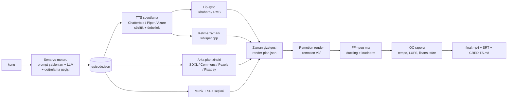

# FAZ 4 — Mimari karar ve yol haritası

## Kararlar

### K1. Render motoru: Remotion, ayrı alt paket (`remotion-v3/`)

Mevcut motor (SVG dizesi → `sharp` → PNG → FFmpeg) deterministik ve çalışıyor, ama yazı/altyazı, kamera, geçiş,
filtre ve önizleme gibi işleri her seferinde elle yazmayı gerektiriyor. Remotion aynı TypeScript/React yığınında
kare-kesin animasyon (`useCurrentFrame`, `spring`, `interpolate`), tarayıcı kalitesinde yazı, CSS filtreleri, paralel
render ve Studio önizlemesi veriyor. Lisans: birey ve ≤3 kişilik şirket için ücretsiz (Atölye kişisel stüdyo → uygun).

Ayrı alt paket olmasının nedeni: kök `package.json`/`package-lock.json` canlı yayın nitelemesinin (bağımlılık hash'leri)
ve AYAS'ın `dependency-update` hattının parçası. Remotion'u köke eklemek canlı derlemeyi ve niteleme setini değiştirirdi.
`remotion-v3/` kendi `node_modules`'unu taşır; kök `tsconfig`/ESLint onu hariç tutar, kendi `tsc --noEmit`'i vardır.

### K2. Orkestrasyon: kök TypeScript CLI, mevcut pipeline'a dokunmadan

- Saf mantık `src/lib/v3/**` (şema, doğrulayıcı, TTS, lip-sync, zaman çizelgesi, arka plan, müzik, mix, QC).
- Tek komut: `npx tsx scripts/atolye-v3.ts uret --konu "…" --sure 8dk` (adım önbellekli, `--from-step`, `--onizleme`).
- Remotion'a tek bir **render planı JSON**'u verilir, `npx remotion render` alt süreç olarak çağrılır.
- Bu bir bölüm üretim aracıdır; `PipelineRunner`'ın yerine geçmez, ikinci bir pipeline orkestratörü değildir.
  Web uygulamasının stüdyo akışına bağlanması (ör. `ATOLYE_ENGINE=v3` ile `video`/`assembly` aşamasında v3 render'ı)
  üretim varsayılanını değiştirdiği için **ayrı ve owner onaylı** bir sonraki iştir.

### K3. Veri sözleşmesi: `episode.json` + JSON Schema

`docs/v3/episode.schema.json` + `src/lib/v3/episode/EpisodeValidator.ts`. Bütün modüller bunu okur/yazar.
Yapılandırma dosyaları YAML yerine **JSON** (`content/v3/voices.json`, `lexicon_tr.json`, `music_index.json`): kökte
YAML ayrıştırıcı yok ve bağımlılık eklemek K1'deki niteleme setini değiştirirdi.

### K4. Karakter: kendi SVG rig'imiz (owner'ın referans görseli stilinde)

Codex'in "illustrated v4" yönü (beyaz yuvarlak kafa, kalın kontur, sarık/kavuk, kaftan, beyaz eldiven) owner'ın
paylaştığı saray görseliyle aynı aile. V3 bunu React SVG rig'i olarak yeniden kurar: ileri kinematik eklemler,
dış hatlı uzuvlar, vizemli ağız, duygu kaşları, efekt katmanı. Aksesuarlar **SVG dosyası + `pack.json`** olarak
`remotion-v3/public/costumes/<paket>/` altında: yeni dönem = yeni klasör.

### K5. Ses: Chatterbox Multilingual + owner ses klonu

Owner kendi sesini (47,7 sn) klonlama için verdi. Anlatıcı owner sesi; karakterler aynı klon üzerinde perde/tını/hız
ve duygu (exaggeration) farklarıyla ayrıştırılır. Ses verisi git'e girmez (`D:\ÜRETİM\private\v3-voices`).
Piper `dfki` yalnız önizleme yedeği (NC lisans — final QC'de uyarı). Azure/ElevenLabs ücretli → owner onayı.

### K6. Arka plan: stil tutarlılığı önce

Referans kanal vektör illüstrasyon arka planları kullanıyor; çöp adamın arkasına modern fotoğraf koymak üslubu bozar.
Bu yüzden: (1) sahne arka planı = yerel SDXL "flat 2D illustration" (sabit stil istemi + seed), (2) harita/tablo
eki = Wikimedia Commons (PD/CC0/CC BY/CC BY-SA beyaz listesi, `credits.json`), Ken Burns. Pexels/Pixabay sağlayıcıları
API anahtarı verilirse etkin. Hepsine ortak renk/blur/vinyet birleştirmesi.

### K7. Müzik/SFX/mix

Müzik: lisansı kayıtlı kütüphane (`music_index.json`), sahne duygusu → ruh hali; SFX: kod ile sentezlenen özgün
efektler (lisans sorunu yok). Mix: FFmpeg sidechain ducking + iki geçişli `loudnorm` (−14 LUFS, TP −1), 48 kHz AAC.

## Hedef mimari

## Yol haritası

| Faz | Çıktı | Kabul ölçütü | Tahmini süre |
| --- | --- | --- | --- |
| 5.1 Senaryo | şema + doğrulayıcı + prompt şablonları + Fatih pilot `episode.json` | doğrulayıcı testleri PASS; pilot ≥%30 diyalog, hook ≤10 sn | 0,5 gün |
| 5.2 Karakter | rig, 8 duygu, vizemler, hareket kütüphanesi, Fatih kostüm paketi, vitrin kompozisyonu | vitrin render'ı kare kare incelendi | 1 gün |
| 5.3 TTS | sağlayıcı arayüzü, Chatterbox + Piper, `voices.json`, sözlük, önbellek | 5 karakter × 2 satır örnek klasörü | 0,5 gün |
| 5.4 Lip-sync | Rhubarb + RMS yedeği, kelime zamanları | 3 satırda kayma ≤2 kare | 0,5 gün |
| 5.5 Arka plan | SDXL venv onarımı, Commons sağlayıcısı, lisans filtresi, credits | pilot sahnelerinin hepsi lisanslı | 0,5 gün |
| 5.6 Müzik/mix | müzik indeksi, SFX sentezi, ducking + loudnorm | −14 ±1 LUFS, TP ≤ −1 dBTP | 0,5 gün |
| 5.7 Kamera/altyazı | kamera vuruşları, geçişler, kelime altyazı, yazı kartları, tempo denetleyici | ölü kadraj >6 sn yok | 0,5 gün |
| 5.8 CLI | `atolye-v3 uret`, önbellek, `--from-step`, önizleme/final | uçtan uca tek komut | 0,5 gün |
| 6 Pilot + QC | 60–90 sn Fatih pilotu, QC raporu, owner geri bildirimi | QC listesi | 0,5 gün |
| 6b Tam bölüm | 6–10 dk Fatih bölümü | QC + süre ±%10 | owner pilot onayından sonra |
