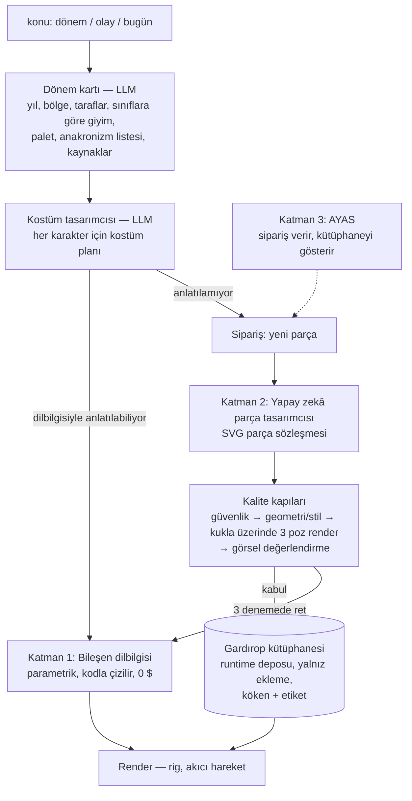

# FAZ 5.9 — Dönem Tasarım Motoru ve kendiliğinden büyüyen gardırop (19 Ekim 2026)

Owner kararları (19 Ekim 2026):
- Bir videonun toplam yapım maliyeti **1 doları geçmeyecek**; OpenAI API bu sınır içinde kullanılabilir.
- Parametrik yaklaşım, model seçimi (senaryo/doğrulama `gpt-4.1`, kalıplı işler `gpt-4.1-mini`) ve yeni iş sırası kabul edildi.
- Gardırop yalnız Osmanlı için değil: **bütün medeniyetler, bütün zamanlar, geçmişte ve günümüzde yaşanan olaylar ve siyaset**
  anlatılabilmeli. Bu yüzden çok büyük bir gardırop ve onu üretebilecek bir "zekâ" gerekir — Atölye'nin kendisi ya da
  Atölye için tasarlayan AYAS; Atölye işleyip videoya dönüştürür.

## 1. Bugünkü durum ve neden yetmiyor

- Gövde kıyafeti koda gömülü 7 sabit tip (`kaftan`, `cubbe`, `zirh`, `onluk`, `bizans`, `yeniceri`, `sade`); tek beden tipi.
- Başlık, sakal/bıyık, el nesnesi: elle çizilmiş SVG'ler, yalnız `ottoman-1453` (17) ve `byzantine-1453` (7).
- Arka plan: Commons + elde hazır 1453 sahneleri; yerel SDXL ortamı bozuk.
- Sabit bir katalog (ne kadar büyük olursa olsun) "her şey"i karşılayamaz: gardırobun **kendiliğinden büyümesi** gerekir.

## 2. Mimari: üç katman

### Katman 1 — Bileşen dilbilgisi (parametrik, kod, ücretsiz)

Sabit kıyafet yerine **birleştirilebilir parçalar**; kombinasyonlar binlerce görünüm verir:
- **Beden:** boy, gövde genişliği, kafa oranı; erkek / kadın / çocuk / yaşlı; saç (kısa, uzun, topuz, örgü, kel) ve
  sakal/bıyık parametrik (uzunluk, biçim, renk). Ev stili (beyaz kukla kafası) korunur.
- **Gövde:** siluet (cübbe/kaftan, tunik, toga/drape, ceket, palto/redingot, frak, elbise/entari, zırh, tulum, takım elbise,
  gömlek) × boy × bolluk × yaka × önlük/yelek/pelerin katmanı × kuşak/kemer/çapraz kayış × desen (düz, çizgili, kareli,
  çiçek motifi, kürk, kamuflaj) × nişan (düğme sırası, apolet, rütbe şeridi, madalya, kol bandı, rozet, kravat/papyon).
- **Başlık:** taban biçim (kubbe, koni, silindir, sarık sargısı, taç bandı, kep, kukuleta, başörtüsü, miğfer kabuğu) ×
  değiştiriciler (siper, sorguç, tüy, sivri uç, yanak koruyucu, bant, taş, peçe, defne).
- **El nesnesi:** biçim dilbilgisi (namlu/bıçak + balçak + kabza; sap + baş; kalkan biçimi + arma) ve günümüz nesneleri
  (pankart — üzerinde metin, mikrofon, telefon, kâğıt/gazete, çanta, kamera, dizüstü).
- **Renk belirteçleri:** parçalar sabit renk değil `ana / ikincil / iç / süs / metal` belirteçleriyle çizilir; aynı parça
  her karakterde yeniden renklenir. Mevcut 1453 paketleri geriye uyumlu çalışmaya devam eder.

### Katman 2 — Yapay zekâ parça tasarımcısı (üretken, kütüphaneyi büyütür)

Kostüm tasarımcısı bir öğeyi dilbilgisiyle anlatamazsa (samuray kabutosu, Aztek tüy başlığı, astronot kaskı…) **sipariş** verir:
1. LLM katı bir **parça sözleşmesine** göre SVG yazar: yuva (baş/sakal/bıyık/el/sırt/gövde katmanı), bağlantı noktası,
   koordinat çerçevesi, yalnız renk belirteçleri, kontur kalınlığı, en fazla yol/boyut.
2. **Kalite kapıları:** (a) mevcut güvenlik filtresi (script/href/url yok); (b) geometri ve stil denetimi (yuva sınırları,
   kontur, palet); (c) parça referans kuklaya giydirilip 3 pozda render edilir; (d) görsel değerlendirme — yerel
   `gemma4:12b` (görme yeteneği var, ücretsiz) veya bütçe içinde `gpt-4.1-mini`: "Bu bir <öğe> mi, <dönem>e uygun mu,
   stil tutarlı mı, bozuk çizgi var mı?" puanı.
3. Kabul edilen parça **gardırop kütüphanesine** yazılır: Atölye runtime deposunda (repo dışında), yalnız ekleme
   (eski parça silinmez, üzerine yazılmaz), köken kaydıyla (istem, model, maliyet, puanlar, dönem/medeniyet/sınıf
   etiketleri, kaynaklar). 3 denemede geçemeyen sipariş en yakın dilbilgisi parçasına düşer, üretim durmaz.
4. Kütüphane **bir kez tasarlananı sonsuza dek ücretsiz** yeniden kullanır: her yeni konu eksik parçaları ekler, gardırop
   kendiliğinden büyür. Etiketlerle aranır (medeniyet, yüzyıl, sınıf, işlev).

### Katman 3 — AYAS bağlantısı

- AYAS'ın yürütücüleri bilerek salt okunurdur; yazma işleri ayrı ve bugün kapalı bir onay törenine bağlıdır. Bu yüzden
  parçayı **Atölye'nin V3 hattı üretir**, AYAS doğrudan yazmaz.
- AYAS **sipariş verir** ("Roma için gardırop hazırla", "bu haftaki gündem için kadro kur") ve kütüphaneyi, bekleyen/
  reddedilen siparişleri **gösterir** — Gelişim Merkezi'nde bir alt sayfa/sekmede (homepage kuralı gereği ana sayfada değil).
- Boş zaman işi: AYAS, yalnız yerel modelle (ücretsiz) sıradaki konular için önceden parça tasarlatabilir.
- Bu katman AYAS'a dokunduğu için **ayrı ve owner onaylı** bir sprint olarak yapılır; Katman 1–2 önce Atölye'de çalışır.

## 3. Ortam

Her sahne için LLM, Commons sorgusu (TR + EN + kategori) ve sabit stil SDXL istemi yazar. Gerçek tarihî/güncel görsel
veya harita önce Commons'tan (lisans filtresiyle), yoksa yerel SDXL ile aynı düz 2D stilde üretilir (RTX A2000 12 GB,
~15–20 sn/görsel, 0 $). SDXL ortamı `v3-tools` altında yeniden kurulur. Üretilen sahneler de kütüphane mantığıyla saklanır
(etiketli, yeniden kullanılabilir).

## 4. Maliyet (tavan 1 $/video)

| Adım | Nerede | Tahmini |
| --- | --- | --- |
| Senaryo + tarih doğrulama | `gpt-4.1` | ≈ 0,20–0,25 $ |
| Dönem kartı, kostüm planı, sahne istemleri | `gpt-4.1-mini` | ≈ 0,02 $ |
| Yeni parça (SVG + görsel değerlendirme, denemeler dahil) | `gpt-4.1-mini` (+ yerel `gemma4:12b`) | ≈ 0,01–0,02 $ / parça |
| Dilbilgisi parçaları, kütüphanedeki parçalar, arka plan, ses, müzik, render | yerel | 0 $ |

- Hiç görülmemiş bir medeniyetin ilk videosu ~20–30 yeni parça ister (≈ 0,3–0,5 $); toplam yine 1 $ altında.
  Sonraki videolar bu parçaları ücretsiz kullanır.
- Her ücretli çağrıdan önce `governProductionCostCheckpoint` (tavan 1,00 $); aşacaksa çağrı yapılmaz: senaryo yerel
  Ollama'ya düşer, kalan parça siparişleri en yakın dilbilgisi parçasıyla karşılanıp sonraya (yerel model veya sonraki
  video) ertelenir. Fiyatlar `src/lib/ai/AiPricing.ts`'ten; tabloda olmayan model kullanılmaz. OpenAI görsel API'si kullanılmaz.

## 5. Günümüz olayları ve siyaset için koruma

- Yaşayan kişiler karikatürdür ve saygılı çizilir; hakaret, iftira ve doğrulanmamış iddia yoktur.
- Tarih doğrulama geçişi yaşayan kişileri ve hassas siyasi iddiaları ayrıca işaretler (Türk hukuku, örn. TCK 299; YouTube
  politikaları); böyle bölümler yayından önce owner onayına düşer.
- Bayrak, arma ve semboller dönem kartında doğrulanmış biçimlerle çizilir; nefret sembolleri çizilmez.

## 6. Kabul ölçütü

Elle çizim yapılmadan, birbirinden çok farklı dönemlerden otomatik kadro kartı + birer kısa sahne:
**1453 İstanbul**, **Roma (Sezar dönemi)**, **Kurtuluş Savaşı (1919–1922)** ve en az bir **günümüz** konusu.
Her biri < 1 $, anakronizm raporu, kaynak notları ve kütüphaneye eklenen parçaların köken kaydıyla.

## 7. Uygulama sırası

1. Ses örnekleri (sürüyor; owner seçecek).
2. Senaryo motoru + 1 $ koruması (Atölye `AIRouter` + `AiPricing` + `governProductionCostCheckpoint`).
3. Katman 1: beden + bileşen dilbilgisi + renk belirteçleri; dönem kartı ve kostüm tasarımcısı.
4. Katman 2: parça sözleşmesi, kalite kapıları, gardırop kütüphanesi; SDXL ortamı.
5. Ağız senkronu, müzik ve ses dengesi; tek komut orkestratörü.
6. Dört dönem testi + Fatih pilotu.
7. Katman 3: AYAS bağlantısı (ayrı, owner onaylı sprint).
